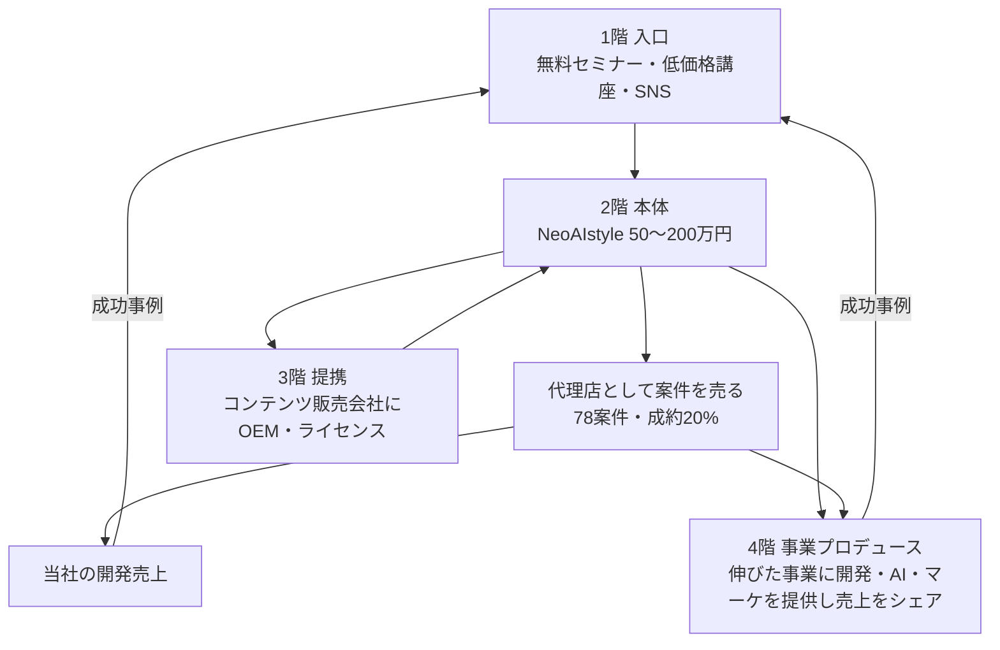

# NeoAIstyle 事業設計（案）

> 営業・AI活用・事業づくり・マーケ・習慣・経営を一緒にやるフルサポートプログラム。
> 受講生を「AI事業のオーナー」に育て、当社の78案件を売る代理店にし、伸びた事業はプロデュースして利益をシェアする。
> 最終ゴール：**100事業をプロデュースし、収入の柱を100本つくる。**
> 名前は仮です。使う前に商標を確認してください（特許庁の検索サービス J-PlatPat）。

---

## 1. 全体の仕組み：4階建て

一番大事なポイントは、**受講料を払った人が、受講中に「代理店として案件を売る」ことで受講料を取り戻す道がある** ことです。
これで「高額講座」ではなく「事業への投資」になり、50〜100万円でも売れます。
同時に、当社には営業マンが増え、開発の売上が増えます。

---

## 2. 2階：NeoAIstyle 本体（商品設計）

### 教える・一緒にやる7つの柱
| 柱 | 内容 | 届け方 |
|---|---|---|
| ① AI活用 | 生成AI・自動化ツールの使い方、自分専用のAI社員づくり | 動画教材＋ワーク |
| ② AI事業の設計 | その人の経験・人脈に合ったAI事業を一緒に決めてカスタマイズ | 個別面談 |
| ③ 営業 | 営業フロー（09）、台本、トスアップ、クロージング | 動画＋ロープレ＋**営業同行** |
| ④ マーケティング | SNS発信、LP、LINE導線、広告の基礎 | 動画＋添削 |
| ⑤ 習慣・マインド | 毎日の行動管理、目標設定、継続のしくみ | 毎朝の報告（AIコーチ）＋週1回の振り返り |
| ⑥ 経営 | 数字の見方、価格設定、利益管理、外注の使い方 | グループ講義 |
| ⑦ 代理店権利 | 当社の78案件を売れる権利、案件ボード、提案資料、報酬20% | 認定テスト後に付与 |

### プランと価格
| | スタンダード | プロ（おすすめ） | パートナー |
|---|---|---|---|
| 価格（税別） | **55万円** | **99万円** | **198万円** |
| 期間 | 3ヶ月 | 6ヶ月 | 12ヶ月 |
| 動画教材・テンプレ・コミュニティ | ◯ | ◯ | ◯ |
| グループ講義（週1） | ◯ | ◯ | ◯ |
| 個別面談 | 月1回 | 月2回 | 週1回 |
| 営業同行・同席 | — | 3回 | 無制限（目安月4回） |
| 自分専用のAI社員・ツール構築 | テンプレ提供 | 1つ構築 | 3つ構築 |
| 代理店権利（78案件・報酬20%） | ◯ | ◯ | ◯（報酬25%） |
| 自分の事業のLP・SNS初期設計 | — | ◯ | ◯＋広告運用の伴走 |
| 事業プロデュースの審査 | — | 申込可 | 優先審査 |
| 卒業後の月額コミュニティ | 月2.2万円 | 月2.2万円 | 半年無料 |

- 一括と分割（カード・ローン）を用意する
- 最初の1期生10名は **モニター価格（33万円〜）** にして、実績と声を集める
- 価格の根拠：営業コンサルの顧問相場が月30〜100万円。6ヶ月で99万円は、営業・AI・事業づくりの全部込みで相場より安い

### 受講料が戻る計算（パンフに載せる例）
> プロ（99万円）の受講生が、6ヶ月でLP（25万円）を4件、AIチャットボット（55万円）を2件成約
> → 報酬 25万×20%×4 ＋ 55万×20%×2 ＝ **42万円**
> ＋ 自分のAI事業の売上
※「必ず稼げる」とは書かない（下の「法律の注意」参照）

### 1人で何人まで見られるか（ボトルネック対策）
- 教える部分は **動画＋テンプレ＋AIコーチ（自社AI社員）** にして、人は個別面談と営業同行に集中
- 目安：コーチ1人で受講生20〜30人
- 卒業生の中から成果を出した人を **認定コーチ** にして、報酬を払って指導してもらう

---

## 3. 1階：入口（集客）

| 入口 | 価格 | 役割 |
|---|---|---|
| SNS発信（X・Instagram・YouTube・TikTok） | 無料 | AIで作った制作物、受講生の成果、事業づくりの裏側を見せる |
| 無料オンラインセミナー（月2回） | 無料 | 「AIで事業を持つ方法」→ 個別相談へ |
| AI活用ミニ講座 | 1万〜5万円 | お試し。受講者の2〜3割を本体へ |
| 個別相談（30分） | 無料 | 窓口クローザーが担当（09のフローと同じ） |
| 紹介 | 紹介料10% | 卒業生・代理店からの紹介 |

---

## 4. 3階：提携（コンテンツ販売会社に卸す）

パッケージが売れて型ができたら、**すでにお客様を持っているところ** に売ってもらう。

### 提携先の候補
- オンラインスクール・講座を売っている会社
- コミュニティ・オンラインサロンの運営者
- インフルエンサー・YouTuber
- 経営者団体・士業ネットワーク
- 副業・起業支援の会社

### 提携の形（3種類）
| 形 | 提携先がやること | 当社がやること | お金の分け方（目安） |
|---|---|---|---|
| 紹介提携 | 自分のお客様に紹介 | 販売・指導すべて | 受講料の20〜30%を提携先へ |
| 共同販売 | 集客・セミナー開催 | 個別相談・指導・案件提供 | 受講料を50:50 |
| OEM・ライセンス | 自社ブランドで販売・一部指導 | 教材・テンプレ・AIコーチ・代理店案件・開発 | 受講者1人あたり定額（例：20〜30万円）か売上の30〜40% |

- どの形でも、受講生が代理店として売った案件の **開発は当社** がやる → 提携が増えるほど開発の売上も増える
- 提携先が多くても回せるように、教材・AIコーチ・管理画面を **1つの仕組み（プラットフォーム）** にしておく

---

## 5. 4階：事業プロデュース（100事業・収入の柱100本）

### 対象
受講生・代理店・提携先の中で、**伸びそうな事業** を審査して選ぶ。

### 当社が出すもの・相手が出すもの
| 当社 | 相手（事業オーナー） |
|---|---|
| システム・アプリ・AI社員の開発 | 現場の運営・お客様対応 |
| マーケティング（LP・SNS・広告） | 業界の知識・人脈 |
| 営業の仕組みと代理店網 | 毎日の営業活動 |
| 経営の数字の管理（ダッシュボード） | 数字の報告 |

### お金の取り方（おすすめ順）
1. **売上の3〜10%をシェア**（レベニューシェア）
   - 「利益」だと経費の付け方で変わってしまうので、**売上** を基準にするのが揉めにくい
2. **開発費を割り引く代わりに、売上シェアを上乗せ**（例：開発費を半額にして、売上の10%を3年間）
3. **株を持つ（出資）**：本当に大きくなりそうな事業だけ。10〜30%

### 審査の基準（スコアで決める）
| 項目 | 見るところ |
|---|---|
| オーナー | 毎日行動しているか（習慣のデータで見える） |
| 市場 | お金を払う人がはっきりいるか |
| 当社との相性 | 当社の開発・AIで差がつくか |
| 数字 | 3ヶ月で月30万円の売上が見込めるか |
| 拡大 | 代理店網で横に広げられるか |

### 100事業を回す仕組み
- 全事業の数字を **1つのダッシュボード** で毎日見る（売上・シェア額・行動量）
- 事業ごとに「検証 → 拡大 → 自走」の3段階で、当社の関わり方を減らしていく
- うまくいった事業の型をテンプレ化して、別の地域・業種にコピーする（例：飲食店向けSNSツール事業を全国に）

### 100本の柱になるまでの数字（例）
| | 1年目 | 2年目 | 3年目 |
|---|---|---|---|
| NeoAIstyle 受講生（累計） | 60人 | 200人 | 500人 |
| 提携先 | 3社 | 10社 | 20社 |
| 代理店として動いている人 | 30人 | 120人 | 300人 |
| プロデュース事業 | 5 | 30 | 100 |
| 1事業あたりの月のシェア額（平均） | 5万円 | 8万円 | 10万円 |
| シェア収入（月） | 25万円 | 240万円 | **1,000万円** |

※あくまで目標の例です。実際は1期生の結果を見て直す。

---

## 6. 収入の柱（全体像）
| 柱 | 種類 |
|---|---|
| 受講料（NeoAIstyle） | 単発・高額 |
| 卒業後コミュニティ | 月額 |
| 代理店経由の開発売上（78案件） | 単発＋保守の月額 |
| 提携のライセンス料 | 定額・成果 |
| AIツール・SaaSの月額（受講生・事業に提供） | 月額 |
| プロデュース事業の売上シェア × 100 | 月額（積み上がる） |
| 出資した事業の株の価値 | 将来 |

---

## 7. 法律の注意（必ず専門家に確認）
この形は、内容によって法律の規制がかかります。**始める前に、特定商取引法にくわしい弁護士に確認してください。**

| 注意点 | 内容 | 対策 |
|---|---|---|
| 業務提供誘引販売取引 | 「講座を買えば、当社が仕事（案件）を紹介して収入になる」という売り方は、これに当たる可能性が高い | 法定の書面を渡す、20日間のクーリングオフ、収入の誇大表示をしない |
| 連鎖販売取引（マルチ） | 「受講生が次の受講生を勧誘すると報酬」が何段にも続くとマルチ扱いになる | 報酬は **実際の案件の成約だけ**、紹介報酬は **1段だけ** |
| 広告表示 | 「誰でも月100万」「必ず回収できる」は景品表示法・特商法で問題になる | 実績は「個人の結果」と明記、平均や条件も載せる |
| 契約 | 高額・長期のサービスは途中解約の扱いでトラブルになりやすい | 解約・返金のルールを契約書に明記 |
| ステマ規制 | 提携先・代理店のSNS紹介 | 「PR」「広告」表記を必須にする |

---

## 8. 進め方（最初の6ヶ月）
| 時期 | やること | ゴール |
|---|---|---|
| 0〜1ヶ月 | カリキュラム・教材の骨組み、商標確認、弁護士相談、LP・セミナー準備 | 売れる状態にする |
| 1〜3ヶ月 | 1期生10名（モニター価格）。毎週の改善 | 成功事例3つ |
| 3〜6ヶ月 | 正規価格で2期生20〜30名。認定コーチ制度の準備 | 月500万円の受講料売上 |
| 6ヶ月〜 | 提携先3社と試験販売。プロデュース事業5つ目まで | 4階建てが全部動く |

## 9. 最初に決めること
- [ ] プログラム名（商標確認）
- [ ] 3プランの中身と価格の最終決定
- [ ] 代理店報酬の率（通常20%／パートナー25%）
- [ ] 売上シェアの率と期間
- [ ] 1期生の募集方法と人数
- [ ] 弁護士の確認（特商法・契約書）
