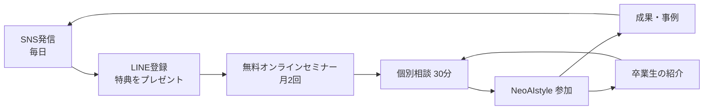

# NeoAIstyle 参加費用・受講生の教育・集客（案）

---

## 1. 参加費用

### 価格は「期」ごとに上げていく
| 期 | 人数 | プロ（6ヶ月）の価格 | 目的 |
|---|---|---|---|
| 1期（モニター） | 10名 | **33万円** | 成功事例と受講生の声を集める。声・数字の公開に協力してもらう |
| 2期 | 20〜30名 | **55万円** | 1期の事例で売る。カリキュラムを固める |
| 3期以降（正規） | 30名〜 | **99万円** | 実績が増えた段階で正規価格へ |

正規価格のプラン（3期以降）
| | スタンダード | プロ（おすすめ） | パートナー |
|---|---|---|---|
| 価格（税別） | 55万円・3ヶ月 | 99万円・6ヶ月 | 198万円・12ヶ月 |
| 中身の違い | 教材＋グループ講義＋月1面談 | ＋月2面談・営業同行3回・AIツール1つ構築 | ＋週1面談・営業同行・AIツール3つ・広告伴走・プロデュース優先審査 |

### 払い方
- 一括（一括なら5%引きなど）
- 分割：カード分割、またはショッピングローン（提携会社の審査が必要）
- 卒業後のコミュニティ：月2.2万円（任意）

### 返金ルール（成果ではなく行動で保証する）
- 「売上が出なければ返金」は約束しない（集客に使うと誇大広告になりやすく、赤字にもなる）
- おすすめ：**「最初の30日間の課題を全部やって、それでも合わないと思ったら全額返金」**
  - 本気の人だけが入る／やらない人は返金対象外になる
- 途中解約のルール（残り期間分の返金方法）を契約書に書く

### 法律で確認すること（弁護士に）
- AIツールの操作を教える部分が大きいと、特定商取引法の「特定継続的役務提供」の **パソコン教室** に当たる可能性がある（期間2ヶ月超・5万円超が対象）。当たる場合は、契約書面・8日間のクーリングオフ・中途解約のルールが必要
- 「経営・事業づくりのコンサル」が中心の設計なら当たりにくいが、判断は専門家に任せる

---

## 2. 受講生の教育

### 基本の考え方
- **教える → やらせる → 一緒にやる → 振り返る** を毎週まわす。動画を見るだけで終わらせない
- 1人ずつ「どんな事業をつくるか」を最初に決めて、その事業を実際に動かしながら学ぶ
- 教える部分は動画・テンプレ・AIコーチに任せ、人は「面談・営業同行・振り返り」に集中する

### 最初の14日間（ここで続くかどうかが決まる）
| 日 | やること |
|---|---|
| 1日目 | キックオフ面談：目標、使える時間、得意なこと・人脈を聞く |
| 3日目 | 事業タイプを決める（下の4タイプ）＋90日計画を一緒に作る |
| 7日目 | 自分専用のAI社員（AIアシスタント）を設定して、毎日使い始める |
| 14日目 | 最初の発信・最初のアプローチを1件やる → 面談で振り返り |

### 事業タイプ（その人に合わせたカスタマイズ）
| タイプ | 向いている人 | 例 |
|---|---|---|
| AI制作代行型 | パソコン作業が好き | 動画編集・バナー・LPをAIで作って受注 |
| 業界特化DX型 | 飲食・美容・不動産などの現場経験がある | その業界向けにAIツール・SNS運用を提案 |
| コンサル・講師型 | 人に教えるのが得意 | 地域の中小企業向けAI活用セミナー・顧問 |
| 自社商品型 | 作りたいサービスがある | AIを使った自社サービス・アプリ（プロデュース候補） |

### 6ヶ月のカリキュラム（プロ）
| 時期 | テーマ | 中身 | ゴール |
|---|---|---|---|
| 1ヶ月目 | AIの土台・習慣 | 生成AI・自動化の基本、AI社員づくり、毎日の行動記録 | 毎日AIを使っている |
| 2ヶ月目 | 事業設計 | 誰に・何を・いくらで、商品と価格、LP・プロフィール作成 | 売るものと価格が決まっている |
| 3ヶ月目 | 集客・発信 | SNS発信、LINE導線、セミナーのやり方 | 毎週発信、見込み客が集まり始める |
| 4ヶ月目 | 営業 | 営業フロー、台本、ロープレ、営業同行 | 商談ができる、最初の売上 |
| 5ヶ月目 | 仕組み化 | 外注・AIでの自動化、テンプレ化、作業時間を減らす | 1人でも回る形 |
| 6ヶ月目 | 経営・拡大 | 数字の見方、利益管理、次の半年の計画 | 月の売上目標と計画がある／プロデュース審査 |

### 届け方
| 形 | 頻度 | 内容 |
|---|---|---|
| 動画教材 | いつでも | 1本10〜15分。見たらすぐやる課題つき |
| グループ講義（オンライン） | 週1回・60分 | 新しいテーマ＋受講生の事例共有 |
| 個別面談 | 月2回・30分 | 進み具合の確認と次の一手 |
| 営業同行・同席 | 期間中3回 | 実際の商談に一緒に入る |
| AIコーチ（自社AI社員） | 毎日 | 行動報告への返信、質問対応、課題の添削 |
| コミュニティ（Discordなど） | 毎日 | 質問、成果報告、仲間どうしの励まし |
| テンプレ集 | いつでも | 営業台本、提案書、LP構成、SNS投稿の型（今回の営業キットを流用） |

### 途中でやめさせない仕組み
- **毎日の行動報告**：発信数・アプローチ数・学習時間をAIコーチに送る
- **3日報告がなければ** コーチから連絡
- **バディ制度**：同じ期の2〜3人で組んで、週1回お互いに報告
- **行動量のランキング**（売上ではなく行動量で並べる）
- 期の真ん中（3ヶ月目）に、全員と「やり直し面談」

### 受講生の成果を測る指標
| 種類 | 指標 |
|---|---|
| 行動 | 課題の提出率、週の発信数、週のアプローチ数、商談数 |
| 成果 | 初売上までの日数、卒業時の月売上、継続率 |
| 満足 | 面談後アンケート、紹介してくれた人数 |

### コーチの体制
- コーチ1人で受講生20〜30人まで
- 成果を出した卒業生を **認定コーチ** に（面談1回あたり、または受講生1人あたりで報酬）
- 面談の記録と次の一手を共有シートに残し、誰が担当しても同じ質にする

---

## 3. 参加者を増やす方法

### 一番効くのは「受講生の成功事例」
集客の手法より先に、1期生10名の中から **3つの成功事例** を作ることが最優先。
事例がそろえば、SNS・セミナー・提携、すべての成約率が上がる。

### 集客の流れ（基本）

### 数字の目安（例）
| 段階 | 割合の目安 | 1期あたりの例 |
|---|---|---|
| LINE登録 | — | 1,000人 |
| セミナー参加 | 登録者の10〜20% | 150人 |
| 個別相談 | 参加者の20〜30% | 40人 |
| 参加（成約） | 相談の20〜40% | 10人 |

→ 1期10名には、LINE登録1,000人が目安。まずはここを目標にする。
（割合は高額講座でよく言われる目安。実際の数字で毎回直す）

### 集客の手段（優先順）
| 優先 | 手段 | やること |
|---|---|---|
| ★★★ | **MASA自身の発信** | X・Instagram・YouTube・ラジオ・メルマガ・Discordで、AI事業づくりの裏側、作ったもの、失敗も含めて毎日出す。今あるファン・コミュニティに最初に案内する |
| ★★★ | **成功事例の発信** | 受講生のビフォーアフター（本人の許可を取り、「個人の結果」と明記） |
| ★★★ | **LINE登録特典** | 「AI社員テンプレ」「AI事業タイプ診断」「業種別AI活用アイデア100」など |
| ★★ | **無料セミナー** | 「AIで自分の事業を持つ方法」60分。最後に個別相談を案内 |
| ★★ | **低価格の入口講座** | 1万〜5万円の「AI活用3日間チャレンジ」など。参加者の2〜3割を本体へ |
| ★★ | **卒業生の紹介** | 紹介料10%（1段だけ）、または紹介した人に面談追加などの特典 |
| ★★ | **提携先との共同セミナー** | スクール・サロン・経営者団体のお客様向けに開催 |
| ★ | **広告** | Meta・YouTube広告 → LINE登録。事例がそろってから。1登録あたりの費用を見ながら少しずつ |
| ★ | **リアルの場** | 経営者交流会、商工会議所、地域の勉強会での登壇 |

### 信用を落とさないために（高額講座は疑われやすい）
- 料金・プランの中身・返金ルールを **公開する**
- 特定商取引法の表記をきちんと載せる
- 「誰でも月100万」などは言わない。実績は条件や平均もあわせて出す
- 個別相談で **合わない人には「今は入らない方がいい」と言う**（紹介と口コミが増える）
- 代理店制度の案内は、受講の案内とは別ページで行う（切り離しのルール）

---

## 4. 最初の3ヶ月でやること
- [ ] 1期生の募集ページ（モニター価格33万円・10名）
- [ ] LINE登録特典を1つ作る
- [ ] 無料セミナーの台本とスライド
- [ ] 最初の14日間の流れと課題
- [ ] 1〜2ヶ月目の動画教材
- [ ] AIコーチ（行動報告に返信するAI）の設定
- [ ] 返金ルール・契約書を弁護士に確認
