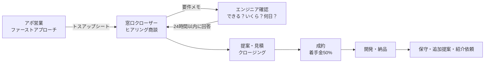

# 営業フロー：アポ営業 → 窓口クローザー → エンジニア確認 → 成約

## 全体の流れ

| 段階 | 担当 | ゴール | 目安時間 | 報酬 |
|---|---|---|---|---|
| ① ファーストアプローチ | アポ営業 | 「一度話を聞かせてください」で商談日を取る | 1社5〜10分 | 成約額の8% |
| ② ヒアリング商談 | 窓口クローザー | お困りごと・作りたいものを聞き出す | 30〜45分 | 成約額の12% |
| ③ エンジニア確認 | 開発チーム | できるか・いくらか・何日か を回答 | 24時間以内 | 社内（報酬なし） |
| ④ 提案・クロージング | 窓口クローザー | 見積提示→申込 | 2回目の商談 or オンライン | （②に含む） |
| ⑤ 成約・着手 | クローザー→開発 | 契約書・着手金50%入金 | — | 入金確認後に報酬確定 |

> アポ営業とクローザーを1人で兼ねる場合は合計20%。紹介だけ（SNS紹介者など）は10%。
> 月額案件はアポ6%＋クローザー9%を12ヶ月。

---

## ① ファーストアプローチ（アポ営業）

### 基本の型
1. **「御社の〇〇を作らせてほしい」** と具体的に言う（何屋か分からない営業は断られる）
2. **「こんなのあったらどうですか？」** と1つだけ例を見せる（相手の業種に合わせる）
3. **「他にも何でも作れます」** と広げる
4. **「一度お話を聞かせていただけませんか？」** でアポを取る（売り込まない。聞きに行く）

### 共通トーク（電話・訪問・DM）
> 突然失礼します。AIで御社専用のツールやシステムを作っている、MASA AIチームの〇〇です。
> 今日は、**御社の〇〇を作らせていただけないか** と思ってご連絡しました。
> 例えば **「〇〇」** のようなものがあったら、〇〇の手間がかなり減ると思うのですが、いかがでしょうか？
> 当社はAIを使うので、普通の開発会社の半分くらいの費用で作れます。
> ホームページや動画から、社内のシステム、AI社員まで、**作りたいものがあれば何でも対応します。**
> 一度、30分ほどお話を聞かせていただけませんか？

### 業種別「こんなのあったらどうですか？」
| 業種 | 最初に見せる1つ | 一緒に言える他の例 |
|---|---|---|
| 飲食店 | 料理の写真を撮るだけでInstagramの投稿文ができるツール | QR注文、LINE予約、原価計算、口コミ返信AI、多言語メニュー |
| 物販・EC | 仕入値を入れるだけで、手数料・送料込みの粗利が自動で出るツール | 価格リサーチ、在庫の一元管理、出品文の自動作成 |
| 美容室・サロン | LINEで予約→来店後に自動でお礼とクーポン | 口コミ返信、SNS投稿ツール、HP |
| 不動産 | 物件情報から紹介文・SNS投稿・動画を自動作成 | 問い合わせ対応AI、顧客管理 |
| 士業・事務所 | 請求書や申込書を読み取って自動で入力 | AI事務員、問い合わせ対応AI |
| 工務店・建築 | 図面から3Dパースを作成 | HP、施工事例の動画 |
| 中小企業全般 | 毎日の転記・集計を自動でやるAI事務員 | 業務システム、チャットボット、採用サイト |
| マーケ会社 | SNSの競合分析・レポートが自動で出るツール | LP・動画の量産、OEM提携（`02`参照） |

### DM・メール版（短文）
> 〇〇様
> 突然すみません。AIで店舗・企業専用のツールを作っているMASA AIチームの〇〇です。
> 御社（お店）向けに **「〇〇」** を作らせていただけないかと思いご連絡しました。
> 例：{案件ボードの「アプローチ文をコピー」で出る文面を貼る}
> 他にも作りたいものがあれば何でもご相談ください。
> 一度30分ほど、お話を聞かせていただけませんか？

### 断られたときの返し
| 言われたこと | 返し |
|---|---|
| 「今は必要ない」 | 「今すぐでなくて大丈夫です。普段どんな作業に時間がかかっていますか？それだけ伺えれば、使えそうなものをまとめてお送りします」 |
| 「お金がない」 | 「小さいものだと10万円台からあります。補助金が使える場合もあるので、それも含めてご案内できます」 |
| 「AIはよく分からない」 | 「分からなくて大丈夫です。使い方は全部こちらで設定して、操作もお教えします」 |
| 「他に頼んでいる」 | 「その会社さんで対応していないもの（動画、AI、ツールなど）があれば、そこだけでもお手伝いできます」 |
| 「資料だけ送って」 | 「承知しました。御社向けの例を入れてお送りしますので、〇日に一度だけお電話してもよろしいですか？」 |

### アポ営業がやってはいけないこと
- 価格・納期を約束する（「〇万円でできます」は言わない。「相場の半分くらい」まで）
- 「何でもタダで」「絶対に売上が上がる」などの約束
- 機能の細かい話（それはクローザーとエンジニアの仕事）

---

## トスアップシート（アポ営業 → クローザー）
アポが取れたら、この項目を埋めて渡す。**空欄が多いアポは報酬対象外** にすると質が上がる。

| 項目 | 記入例 |
|---|---|
| 会社名・店名／業種 | 〇〇食堂／飲食店（2店舗） |
| 担当者名・役職 | 〇〇様／オーナー |
| 連絡先 | 電話・メール・LINE |
| 商談日時・方法 | 11/20 15:00／オンライン |
| 反応がよかった提案 | SNS投稿ツール。「毎日の投稿が大変」と言っていた |
| 困っていること | 人手不足、予約の電話対応 |
| 予算感・決裁者 | 未確認／オーナーが決める |
| 温度感 | A：すぐ欲しい／B：話は聞きたい／C：情報収集 |
| アポ営業の名前 | 〇〇 |

---

## ② ヒアリング商談（窓口クローザー）

### 30分の流れ
| 時間 | やること | 聞くこと・言うこと |
|---|---|---|
| 0〜3分 | あいさつ・目的確認 | 「今日は御社のお困りごとを伺って、作れるものをご提案する場です」 |
| 3〜15分 | 現状を聞く | 「毎日・毎週、時間がかかっている作業は？」「何人で何時間？」「今は何を使っていますか？」 |
| 15〜22分 | 理想を聞く | 「それが自動でできたら、空いた時間で何をしたいですか？」「いつまでに欲しいですか？」 |
| 22〜27分 | 事例・イメージを見せる | 案件ボードから近い案件を2〜3個見せる。価格帯もここで伝える |
| 27〜30分 | 次の約束 | 「エンジニアに確認して、〇日までに具体的なお見積りをお送りします」 |

### 必ず確認する5つ（BANT＋α）
1. **予算**：「だいたいどのくらいまでなら検討できますか？」
2. **決める人**：「最終的にお決めになるのはどなたですか？」
3. **必要性**：何に困っていて、作らないとどうなるか
4. **時期**：いつまでに使いたいか
5. **今使っているもの**：スプレッドシート、LINE公式、POSレジ、会計ソフトなど（連携の可否に関わる）

---

## ③ エンジニア確認

クローザーは商談後 **その日のうちに** 下の要件メモを開発チームに送る。開発チームは **24時間以内** に回答する（遅いと熱が冷める）。

### 要件メモ（クローザー → エンジニア）
- お客様の業種・規模
- 作りたいもの（一言で）
- 必要な機能（箇条書き。「絶対ほしい」と「あれば嬉しい」に分ける）
- 使っているツール・連携したいもの
- 予算感・希望納期
- 参考になる案件ボードの案件名

### エンジニアの回答フォーマット
| 項目 | 回答 |
|---|---|
| 対応可否 | ◯ できる／△ 条件つきでできる／✕ できない（代案） |
| 近い案件 | 案件ボードの〇〇（標準価格〇円） |
| 見積 | 松：〇円（全機能）／竹：〇円（おすすめ）／梅：〇円（最小） |
| 納期 | 着手から〇週間 |
| 前提・リスク | お客様に用意してもらうもの、外部サービスの月額費用など |
| 追加提案 | 保守〇円／月、関連して作れるもの |

> 案件ボードにない「作りたいシステム」は、まず **要件整理・お見積り（30万円、発注時に開発費へ充当）** を提案する。
> ただし小さな相談（社内ツール1〜2機能など）は、無料相談の範囲でエンジニアが概算を出してよい。

---

## ④ 提案・クロージング（窓口クローザー）

### 見積の出し方
- **松竹梅の3つ** で出す。竹を「おすすめ」にする
- 単発の開発に **保守・運用の月額** をセットで付ける
- 値引きは最大10%まで。それ以上は機能を減らして価格を下げる

### クロージングトーク
> 前回伺った「〇〇に毎日2時間かかっている」という件、エンジニアと確認したところ、〇〇の形で自動化できます。
> おすすめはこちらの竹プランで、〇万円、〇週間でお渡しできます。
> 月に〇時間浮くので、人件費で考えると〇ヶ月で元が取れる計算です。
> 着手金は半分の〇万円で、残りは納品後です。
> 今月中にお申し込みいただければ、〇月〇日から着手できますが、いかがでしょうか？

### 迷っているときの一言
| お客様の言葉 | 返し |
|---|---|
| 「高い」 | 「梅プランなら〇万円です。まず小さく始めて、効果を見てから広げる方も多いです」 |
| 「社内で相談する」 | 「どなたとご相談されますか？その方向けに1枚の資料をお作りします。〇日に一度ご連絡してもよろしいですか？」 |
| 「本当にできるの？」 | 「近い事例をお見せします。途中で何度か画面を確認いただきながら進めます」 |
| 「補助金は？」 | 「IT導入補助金などが使えるか、条件を確認してご案内します」（※使えると断言しない） |

---

## ⑤ 成約後
1. 契約書（業務範囲・修正回数・納期・支払い・著作権）を交わす
2. 着手金50%の入金確認 → 開発チームへ引き継ぎ（要件メモ＋エンジニア回答＋見積書）
3. クローザーは **お客様の窓口のまま**（進み具合の連絡、確認のお願い）
4. 納品1ヶ月後：満足度の確認 → **追加提案** と **紹介のお願い**
5. 営業報酬：お客様の入金確認後、月末締め・翌月末払い

---

## KPI（1人あたり・月の目安）
| 役割 | 行動量 | 成果 |
|---|---|---|
| アポ営業 | 200件アプローチ（電話・DM・訪問） | 商談10件（5%） |
| 窓口クローザー | 商談20件 | 成約5件（25%） |
| 開発チーム | 要件メモへの回答 | 24時間以内の回答率90%以上 |

→ アポ営業2人＋クローザー1人で **月5件前後の成約** が目標。平均単価40万円なら月200万円の売上。
